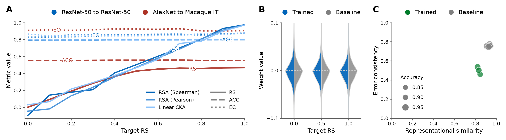

# Representation can dissociate from function and behaviour in task-optimised vision networks

[](https://doi.org/10.5281/zenodo.24163735)

Code and figure sources accompanying our extended abstract
"[Representation can dissociate from function and behaviour in
task-optimised vision networks](https://openreview.net/forum?id=IXC4dtfKgC)"
(CCN 2026).

<p align="center">
  
</p>

## Abstract

Building models that explain how biological brains process information is a
central goal of computational neuroscience. A common way to evaluate such
models is to ask how well they align with neural data. This alignment is
routinely quantified by comparing model and brain representations using
measures such as RSA and CKA. In doing so, high representational similarity is
often taken as evidence of similar computation and behaviour. Here, we show
that representational similarity can dissociate from both function and
behaviour in task-optimised vision networks. Across architectures and datasets,
including comparisons to macaque IT cortex, networks can match a target model's
outputs, task performance, and trial-by-trial behaviour while exhibiting a wide
range of representational similarity scores. Conversely, networks can closely
match task performance and representational similarity, yet differ
substantially in trial-by-trial behaviour. These findings show that
representational similarity alone is insufficient evidence for shared
computation and motivate stricter criteria for brain-model alignment.

## Installation

The project is managed with [uv](https://docs.astral.sh/uv/) and requires
Python 3.12 or newer.

```bash
git clone https://github.com/wichmann-lab/ccn2026-dissociation.git
cd ccn2026-dissociation
uv sync --locked --extra cpu
```

This installs the `dissociation` package together with the dependency
versions pinned in `uv.lock`. The extra selects the PyTorch build: `cpu`
installs the CPU build, which is sufficient to reproduce the figure, run
the tests and execute the demo notebook. To recompute the ImageNet
results on an NVIDIA GPU under Linux, sync with `--extra cuda` instead,
which installs the CUDA build of the same torch version:

```bash
uv sync --locked --extra cuda
```

The two extras are mutually exclusive. Subsequent `uv run --locked`
commands use the selected PyTorch build. On macOS and Windows
PyPI only offers CPU builds, so both extras install the same wheels there.

## Reproducing the figure

`notebooks/figures/figure1.py`, a [marimo](https://marimo.io) notebook,
builds Fig. 1 from the result tables committed under `results/` and writes
`figures/figure1.pdf` and `figures/figure1-preview.png`:

```bash
uv run --locked python notebooks/figures/figure1.py      # headless
uv run --locked marimo edit notebooks/figures/figure1.py # interactive
```

The tables hold one row per trained network (achieved similarity, top-1
accuracy, error consistency), so the figure reproduces in seconds without any
model or dataset. `results/README.md` documents the table columns and the
methods used to compute their values.

> [!IMPORTANT]
> The checkpoints and configurations of the 53 training runs behind Fig. 1
> (33 ResNet-50 and 11 AlexNet sweeps on ImageNet, 9 AlexNet networks on
> CIFAR-10) are archived on Zenodo
> ([doi:10.5281/zenodo.24162774](https://doi.org/10.5281/zenodo.24162774))
> rather than in this repository.
> `scripts/download_runs.py` fetches them into `data/runs/`, and
> `scripts/precompute_results.py` recomputes the tables from the checkpoints
> (accuracy, error consistency and representational similarity to the
> references, measured on the ImageNet validation set and the CIFAR-10 test
> set). The ImageNet validation images are read from the
> [`timm/imagenet-1k-wds`](https://huggingface.co/datasets/timm/imagenet-1k-wds)
> dataset on the Hugging Face Hub (`--imagenet-root`; the download is
> described in `results/README.md`), CIFAR-10 is downloaded automatically.

Reproducibility and scope:

- The figure (from the committed tables) and the result tables (from the
  archived checkpoints) are fully reproducible.
- The demo below trains a network with the augmented Lagrangian scheme of the
  abstract end to end.
- The ImageNet and CIFAR-10 networks themselves were trained with a larger
  framework that will be released with the full manuscript building on this
  abstract. The loss in `dissociation.losses` implements the scheme for one
  representational constraint; the panel-C networks additionally constrained
  error consistency.

The regenerated figure differs slightly from the published one (details in
`results/README.md`):

- Panel A is recomputed from the checkpoints. The published figure took the
  similarity and the accuracy of each run from its training log, where the
  framework had scored the network on the same validation images in its own
  mini-batches and logged three decimals; only error consistency was computed
  from the checkpoints then as now. The recomputed values differ from the
  logged ones by up to 0.005 (linear CKA), 0.0012 (RSA) and 0.0006
  (accuracy), and error consistency is identical. The differences come from
  the rounding of the logged values and from the mini-batches: the
  framework's data loader filled them in a different order than the in-order
  pass used here, and linear CKA on a batch of 1,024 images depends on which
  images it contains.
- Panel B draws the violins from the full `fc.weight` tensors. The published
  figure drew them from a random subsample of 40,000 values per tensor, so
  the two differ marginally near the peaks.
- Panel C sizes the markers by top-1 accuracy on the CIFAR-10 test set,
  computed from the checkpoints. The published figure used the accuracy
  logged during training on the validation split, a held-out fifth of the
  CIFAR-10 training set; the two differ by up to 0.017 for one network.

## Demo

`notebooks/demo/lenet_fashionmnist.py` reproduces the central result at the
smallest scale of the abstract: a LeNet-5 on Fashion-MNIST is trained so that
its penultimate-layer representation reaches a chosen linear-CKA score to a
fixed reference network (here 0.0, maximal dissimilarity) while its logits,
accuracy and trial-by-trial errors stay matched to the reference.

```bash
uv run --locked marimo edit notebooks/demo/lenet_fashionmnist.py
```

Fashion-MNIST is downloaded to `data/` on first use and checkpoints are written
to `out/demo/`; both directories are ignored by git. The bundled reference
network is `models/lenet_fashionmnist_reference.pt`. A full run (80 epochs) took
7 minutes on an Apple M3 Max laptop with the MPS backend and 15 minutes on the
same machine's CPU cores alone (12 threads). With the default settings the run
ends at a test CKA of 0.07 for the target 0.0 (0.04 on the CPU; the two backends
do not produce bit-identical training runs), with the trained network at 0.91
accuracy and an error consistency of 0.90 to the reference, i.e. near-total
representational dissimilarity without a change in behaviour.

## Repository structure

```
ccn2026-dissociation/
├── src/dissociation/
│   ├── colors.py          # OKLCH palette of the figure
│   ├── figure.py          # the three panels and the figure assembly
│   ├── imagenet.py        # ImageNet validation set from WebDataset shards
│   ├── losses.py          # augmented Lagrangian loss, logit MSE
│   ├── metrics.py         # error consistency (Cohen's kappa)
│   ├── models.py          # LeNet-5 and its layer-selection helpers
│   ├── plotting.py        # panel labels, legends, axis styling
│   ├── results.py         # schema and loaders of the result tables
│   ├── runs.py            # parsing of archived training runs
│   └── similarity.py      # linear CKA and distance-based RSA
├── notebooks/
│   ├── demo/lenet_fashionmnist.py   # the demo (marimo)
│   └── figures/figure1.py           # builds Fig. 1 (marimo)
├── scripts/
│   ├── download_runs.py             # Zenodo archive -> data/runs/
│   └── precompute_results.py        # data/runs/ -> results/
├── results/                         # result tables the figure reads
├── figures/                         # Fig. 1 as PDF and PNG
├── models/                          # the demo's reference checkpoint
└── tests/                           # pytest suite
```

## Citation

```bibtex
@inproceedings{theiss2026representation,
  title     = {Representation can dissociate from function and behaviour in task-optimised vision networks},
  author    = {Theiss, Marvin and Fausten, Ben and Wichmann, Felix A.},
  booktitle = {9th Annual Conference on Cognitive Computational Neuroscience (CCN)},
  year      = {2026},
  address   = {New York, NY, USA},
  url       = {https://openreview.net/forum?id=IXC4dtfKgC},
  note      = {Extended abstract}
}
```

## License

The code is released under the [MIT License](LICENSE). The abstract text
quoted above is licensed under CC BY 4.0 by its authors.
